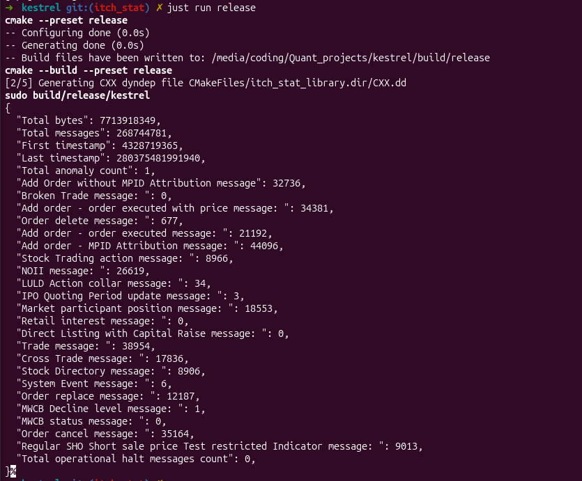

Commands that can be currently used to check things out:
- just clean
- just build release
- just run release itch_stat
- just run release itch_filter
- just build debug
- just run debug itch_stat
- just run debug itch_filter
- gdb ./build/{{preset}}/kestrel where preset = release/debug (to start the debugger)
- Add breakpoint in gdb debugger:
Suppose you want to add a breakpoint at: line of  cpp/itch_stat/src/itch_stat_json.cpp file
use command  - break cpp/itch_stat/src/itch_stat_json.cpp:101

- Load breakpoint from file bp.txt in gdb debugger:
Enter the debugger shell and use the command - source bp.txt to load the breakpoints

How the ITCH stat results are shown in JSON format (with each message type frequency displayed as values)

